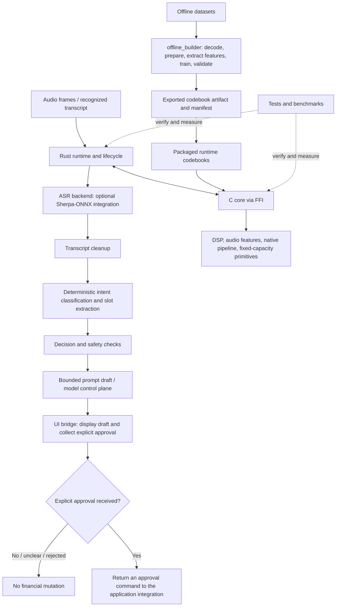

# FinTally Voice

**A bounded-memory, multilingual voice-processing and intent-control subsystem for FinTally.**

FinTally Voice separates low-level audio processing from application-level interpretation and from offline model/codebook preparation. The native C core owns performance-sensitive DSP and fixed-capacity primitives; the Rust runtime coordinates lifecycle, ASR integration, transcript handling, deterministic intent and slot extraction, prompt drafting, and bounded communication between workers. The offline builder prepares datasets and generates artifacts that can be packaged with the runtime.

> **Financial safety rule:** classifying a request is not authorization to perform it. Money-moving requests must be reviewed through an explicit approval path. Negated, ambiguous, incomplete, invalid, or unsupported requests must not authorize a financial mutation. The voice smoke harness and benchmarks do not execute financial operations.

## Contents

- [Goals and design principles](#goals-and-design-principles)
- [Architecture at a glance](#architecture-at-a-glance)
- [Repository layout](#repository-layout)
- [Runtime data flow](#runtime-data-flow)
- [The three main parts](#the-three-main-parts)
- [Codebooks and offline artifacts](#codebooks-and-offline-artifacts)
- [Memory, real-time, and cache constraints](#memory-real-time-and-cache-constraints)
- [Testing strategy](#testing-strategy)
- [Benchmarks and profiling](#benchmarks-and-profiling)
- [Build and development commands](#build-and-development-commands)
- [Data and generated files](#data-and-generated-files)
- [Dependency policy](#dependency-policy)
- [Current boundaries and future work](#current-boundaries-and-future-work)

## Goals and design principles

The project aims to provide a voice-processing path that is measurable, predictable under bounded workloads, and safe to integrate with financial application workflows.

1. **Deterministic logic before model assistance.** Transcript cleanup, intent classification, slot extraction, validation, and approval gates should have deterministic rules. A language model may help phrase or interpret a draft, but must not become the authority that approves a financial action.
2. **Bounded resource use.** Fixed-capacity text, bounded queues, validated input sizes, explicit audio-frame contracts, and a documented runtime memory budget help avoid unbounded allocation in sensitive paths.
3. **Measure before optimizing.** Benchmark an existing implementation, identify the actual bottleneck, make a focused change, then run the same benchmark and correctness tests again.
4. **Separate build-time work from runtime work.** Dataset decoding, feature extraction, codebook training, validation, and export belong in `offline_builder`; they must not be pulled into the latency-sensitive runtime path.
5. **Use C where it provides a measurable benefit.** C provides the native DSP and kernel layer. Rust owns orchestration, ownership boundaries, state handling, and most application logic. Native code should not be added merely for stylistic reasons.
6. **Fail closed.** Invalid input, insufficient slots, competing intents, backend failures, queue pressure, or uncertain interpretation must not accidentally authorize a financial mutation.
7. **Keep modules focused.** Each Rust source file should remain below the project's 1,000-line limit. Split oversized files by responsibility rather than by arbitrary line ranges.

## Architecture at a glance



The diagram represents the intended architectural responsibilities visible from the repository structure. Exact call ordering and any downstream approval executor are determined by the implementation and its integration in the parent FinTally application.

## Repository layout

```text
fintally_voice/
├── Cargo.toml                    # Runtime package, features, dependencies
├── build.rs                      # Builds/binds the native C core for Cargo
├── src/                          # Production Rust runtime
├── c_core/                       # Native C DSP and real-time primitives
├── offline_builder/              # Offline dataset preparation and codebook training
├── benches/                      # Rust runtime and allocation benchmarks
├── examples/                     # Runnable development/smoke examples
├── tests/                        # Rust integration tests
├── scripts/                      # Dataset, validation, benchmark and profiling helpers
└── benchmark-results/            # Local benchmark output; normally not committed
```

### `src/` — normal Rust runtime

This is the application/runtime side. It runs during normal use and coordinates the components that process a transcript or audio frame.

| Path | Responsibility | Why it is separate |
|---|---|---|
| `src/lib.rs` | Crate entry point and public module surface | Provides a controlled API to examples, tests, and other crates. |
| `src/engine.rs`, `src/engine/` | Runtime lifecycle, engine types, and event contracts | Keeps state transitions and runtime contracts explicit. |
| `src/ffi.rs` | Rust-to-C foreign-function interface | Centralizes the boundary between Rust ownership and native C calls. |
| `src/event.rs` | Event representation and bounded text/payload handling | Defines the data carried between processing stages. |
| `src/asr/` | ASR backend setup and recognizer integration | Isolates speech-recognition dependencies and audio/session contracts from intent logic. |
| `src/transcript/` | Transcript cleanup and normalization | Protects downstream parsing from uncontrolled whitespace, filler handling, oversized text, and invalid input. Cleanup must preserve meaningful financial values, payees, and negation. |
| `src/intent/` | Intent classification, rules, and slot extraction | Keeps deterministic request interpretation separate from prompt generation and execution. |
| `src/prompt/` | Bounded prompt drafting and response validation | Constrains model-assisted text and validates the expected workflow/status. It is not an approval authority. |
| `src/threads/` | Worker coordination, queues, producer/consumer paths, UI bridge, and control-plane transport | Isolates concurrency, backpressure, and ownership transfer from the classifier. |
| `src/codebooks/` | Packaged runtime codebook binary | Stores the artifact used by runtime code; it is not the dataset or training workspace. |
| `src/fin_voice_codebooks.rs` | Rust-side codebook integration/loading definitions | Connects runtime code to the exported codebook representation. |

### `c_core/` — native C processing core

The C core contains low-level routines where tight control over data layout, fixed-capacity storage, SIMD dispatch, or per-frame processing is useful.

| Path | Responsibility | Why it belongs in the native layer |
|---|---|---|
| `c_core/include/` | Public C headers and kernel declarations | Establishes explicit interfaces between native components and the FFI shim. |
| `c_core/src/acoustic_dsp.c` | Acoustic DSP orchestration | Groups the native audio-processing path. |
| `c_core/src/mfcc.c` | MFCC feature extraction | Computes a common compact audio feature representation. |
| `c_core/src/energy_zcr.c` | Energy and zero-crossing-rate features | Provides inexpensive frame-level signal features. |
| `c_core/src/lpc_formants.c` | LPC/formant-related processing | Provides spectral/voice characteristics used by downstream processing. |
| `c_core/src/pitch_f0.c` | Fundamental-frequency/pitch processing | Adds pitch-related signal information. |
| `c_core/src/vq_quantize.c` and codebook sources | Vector quantization and codebook registry/data | Maps feature vectors to a finite codebook representation. |
| `c_core/src/voice_pipeline.c` | Native pipeline orchestration | Connects lower-level operations into a processing path. |
| `c_core/src/event_queue.c`, `spsc_ring.c` | Native event and single-producer/single-consumer ring primitives | Supports bounded communication where native code needs it. |
| `c_core/src/language_fsm.c` | Language state-machine functionality | Keeps language-state transitions explicit and inexpensive. |
| `c_core/src/platform_profile.c`, `thermal_policy.c` | Platform/thermal policy support | Lets the runtime account for platform constraints and policies. |
| `c_core/ffi/` | C shim exposed to Rust | Provides a narrow boundary instead of exposing internal C implementation details directly. |
| `c_core/tests/` | Native unit and kernel tests | Validates C components independently from Rust integration tests. |
| `c_core/benchmarks/` | Native DSP, multicontext, and end-to-end pipeline benchmarks | Helps isolate native kernel costs from Rust control-plane costs. |
| `c_core/cmake/` | Compiler options, dependencies, and sanitizers | Centralizes native build configuration. |

The existence of a SIMD-dispatch layer does not prove that SIMD is faster on every target. Scalar and dispatched implementations should be compared with the same input and correctness expectations, including the target CPU's supported instruction set.

### `offline_builder/` — build-time data and model-artifact pipeline

The offline builder is a separate Cargo package for preparing data and producing codebook artifacts. It is not part of normal per-frame runtime processing.

| Path | Responsibility |
|---|---|
| `offline_builder/src/main.rs` | CLI entry point for offline preparation/training/validation workflows. |
| `offline_builder/src/audio/` | Audio decode, conversion, and resampling code. |
| `offline_builder/src/dataset/` | Dataset discovery, manifests, and corpus-specific readers. |
| `offline_builder/src/features/` | Offline feature extraction and associated native bindings. |
| `offline_builder/src/kmeans.rs`, `gpu/` | Codebook clustering, including CPU/GPU paths where configured. |
| `offline_builder/src/validation.rs` | Evaluates generated codebooks and records validation results. |
| `offline_builder/src/export.rs` | Serializes the trained artifact and associated metadata. |
| `offline_builder/ffi/` | C-facing interface used by offline build operations. |
| `offline_builder/output/` | Local/exported artifacts, manifest, and validation report. |
| `offline_builder/build.rs` | Build script for the offline builder's native dependencies. |

**Why this separation matters:** corpus decoding, feature extraction over hours of audio, clustering, and validation can consume substantial CPU, RAM, disk, and GPU time. Performing that work offline avoids putting training dependencies and unpredictable batch workload into the latency-sensitive runtime. The exported codebook is a deployable artifact; the raw audio corpus is training input and should not be required on a production installation.

### `benches/` — Rust benchmark targets

These benchmark targets measure the Rust-facing runtime path independently from the C kernel benchmarks.

- `benches/voice_runtime.rs` measures selected Rust/runtime operations and timing distributions.
- `benches/voice_allocations.rs` measures Rust allocator activity separately from timing runs, since allocation instrumentation can distort latency measurements.

Allocation counts from Rust's global allocator do **not** automatically include memory allocated directly by C libraries, the operating system, or an ASR backend. Use process memory measurements and native instrumentation as separate sources of evidence.

### `examples/` — executable examples

`examples/run_voice_engine.rs` is a development smoke harness. It helps verify native ABI initialization, text cleanup, intent/slot output, prompt drafting, and safe review behavior for a given transcript. It is not an application UI, ASR accuracy benchmark, or financial execution service.

### `tests/` — Rust integration tests

The integration tests cover the cross-module contracts that are difficult to establish from a single module's unit tests:

- `intent_classification.rs`: intent, required slots, source spans, unsupported/unknown requests, and negation behavior.
- `prompt_review_flow.rs`: prompt validation, mutation review, negated-request handling, and transcript injection boundaries.
- `control_plane.rs`: bounded queues, closure, backpressure, worker shutdown, and response validation.
- `engine_lifecycle.rs`: engine lifecycle, frame constraints, and memory-accounting expectations.
- `ffi_abi.rs`: compatibility between Rust bindings and generated/native C headers.
- `transcript_cleanup.rs` and `transcript_cleanup_conservative.rs`: safe normalization and preservation of meaningful text.

Rust unit tests also live next to implementations under `src/`, while native C tests live under `c_core/tests/`.

### `scripts/` — repeatable workflows

The scripts automate workflows that should not be mixed into production runtime logic:

- `benchmark_rust.sh`, `profile_rust_hardware.sh`: run Rust benchmarks and optionally collect operating-system/hardware counters.
- `download_common_voice.sh`, `limit_and_convert.sh`, `prepare_codebook_data.sh`: download/prepare datasets and convert audio for offline training.
- `compare_kmeans_iterations.sh`, `compare_validation_reports.py`: compare offline clustering configurations and validation results.

Review scripts before use: corpus downloads, dataset conversion, training, and profiling may require substantial storage or compute.

## Runtime data flow

The intended responsibilities are divided into stages. Exact implementation details should be confirmed against the current source before changing the call graph.

1. **Acquire a frame or transcript.** Audio-facing code enforces sample-rate, frame-length, and capacity contracts. An ASR backend may produce a transcript; the ASR integration is configured separately from deterministic intent parsing.
2. **Clean the transcript conservatively.** Normalization must not erase amounts, names, account identifiers, dates, currencies, or negation.
3. **Classify the intent and extract slots.** Deterministic rules identify a candidate intent and retain source spans/values where available. Incomplete or competing requests remain unresolved.
4. **Apply decision gates.** A detected mutation is not an authorization. Negation, ambiguity, missing required fields, unsupported requests, and validation errors must not reach a normal confirmation or execution path as if they were safe, complete instructions.
5. **Draft and validate a review prompt.** The model/control-plane interface uses bounded requests and strict output validation. Model output must not overwrite the deterministic safety policy.
6. **Present structured details to the user.** A real UI should show the actual action, amount, payee, and relevant account details. Generic confirmation prose by itself is insufficient to establish informed approval.
7. **Require an explicit approval command.** Approval/rejection must be represented as a separate, validated event or command. Execution should remain in the parent application's authorized financial service, not in the voice smoke harness or benchmark.

## Codebooks and offline artifacts

The current structure contains codebook files in more than one location:

- `offline_builder/output/fin_voice_codebooks.fvcb`: offline export output.
- `offline_builder/output/fin_voice_codebooks.manifest.json`: export metadata/manifest.
- `offline_builder/output/validation_report.md`: validation summary.
- `src/codebooks/fin_voice_codebooks.fvcb`: packaged runtime copy.
- `c_core/src/codebook_*.c` and related generated sources: native codebook data/registry integration.

Treat these as related representations of an artifact, not as interchangeable files. The export/copy/generation process should identify which file is canonical and validate dimensions, language IDs, normalization metadata, version, payload integrity, and manifest agreement before packaging. Do not update the runtime binary and native generated code independently without a reproducible validation path.

Raw and prepared corpora should remain local and out of source control. Small, intentional runtime artifacts may be committed when the project's packaging policy requires them; large training inputs should not be.

## Memory, real-time, and cache constraints

The project uses an embedded-style accounting goal of approximately **100 KiB (102,400 bytes)** for the specifically accounted DSP/runtime working set. That is a project budget, not a claim that every process allocation, every third-party ASR allocation, the OS, or the full program image fits inside 100 KiB.

Use separate ledgers for:

1. accounted real-time/DSP working-set memory;
2. Rust heap allocations and temporary buffers;
3. native C allocations and scratch memory;
4. ASR backend/model memory;
5. process RSS/peak RSS and other OS-level memory.

A 64-byte cache-line boundary is useful on many current CPUs, but it should be used where layout and contention warrant it—not as blanket padding for every type. Check actual target alignment and ABI requirements. `#[repr(C)]` helps specify C-compatible field layout; it does not, by itself, guarantee 64-byte alignment. Over-alignment may increase memory footprint and should be justified by measurement.

Cache capacities and topology vary across the development laptop, Raspberry Pi boards, and ESP32-class targets. Do not claim that a 100 KiB working set fits in L1. Instead, measure the hot working set for each kernel and target; track L1/L2/last-level cache events where hardware counters are available. On the runtime path, prefer fixed-capacity buffers, bounded queues, explicit maximum input sizes, and predictable failure behavior.

Useful latency reports include median, p95, p99, worst observed duration, throughput, and repeat-to-repeat variance. Useful hardware profiles include cycles, instructions, cache events, effective clock/frequency context, thermal state, and thread placement when the platform exposes them. Hardware-counter availability depends on kernel, permissions, virtualization/WSL configuration, and CPU support.

## Testing strategy

Tests should cover more than typical successful input. For each critical component, include as applicable:

- **Happy path:** normal valid frame, valid transcript, supported intent, complete required slots.
- **Boundary path:** empty/minimum/maximum valid payload, exact frame length, queue capacity, input byte cap.
- **Malformed path:** invalid payload, bad status, unknown fields, corrupted artifacts, invalid FFI arguments.
- **Worst bounded workload:** long valid transcript, many tokens, full-size buffers, repeated frames, multiple contexts.
- **Overload path:** full queue, closed channel, unavailable backend, worker shutdown, failed retry, backpressure.
- **Safety path:** negation, uncertainty, missing amount/payee, conflicting intents, unsupported language, prompt injection.
- **Performance path:** repeatable measurements with the same input, compiler configuration, CPU placement, and warm-up policy.

A passing test suite proves the tested invariants for those test cases. It does not by itself establish timing bounds, no allocations on all paths, ASR recognition quality, cache residency, or safety of an external financial execution integration.

## Benchmarks and profiling

Run Rust commands from the `fintally_core` Cargo workspace root unless the workspace configuration says otherwise.

### Correctness before performance

```bash
cargo test -p fintally_voice
cargo check -p fintally_voice --all-targets --message-format=short
```

### Compile and run the Rust benchmark targets

```bash
cargo bench -p fintally_voice --no-run
./fintally_voice/scripts/benchmark_rust.sh
```

If the scripts are run from inside `fintally_voice`, use:

```bash
./scripts/benchmark_rust.sh
./scripts/profile_rust_hardware.sh
```

The benchmark scripts can write CSV/log files under `benchmark-results/`. Those files are local measurement artifacts, so the repository `.gitignore` should exclude them unless a particular report is intentionally curated and committed elsewhere.

For hardware counters, Linux `perf` may be used if installed and permitted by the host/kernel. When running inside WSL or a virtualized environment, hardware counters may be unavailable or incomplete. Keep the fallback timing result and label missing counter values as unavailable; do not substitute estimates and present them as hardware measurements.

### Native C tests and benchmarks

The native C project provides its own `CMakeLists.txt`, presets, test targets, and benchmark targets under `c_core/`. Discover the actual configured presets and options first:

```bash
cmake --list-presets -S fintally_voice/c_core
```

Then use a preset or the option names documented in `c_core/CMakeLists.txt` and `c_core/CMakePresets.json` to enable native tests/benchmarks. The exact option names should be taken from those files; do not assume that a generic `BUILD_TESTS` or `BUILD_BENCHMARKS` option exists.

Do not compare a debug build against a release build and interpret the result as an algorithmic improvement. Record compiler flags, commit, CPU, run conditions, and whether SIMD/LTO/sanitizers were enabled.

## Build and development commands

### Rust unit and integration tests

From the Cargo workspace root:

```bash
cargo test -p fintally_voice
```

Run one focused integration test target, for example:

```bash
cargo test -p fintally_voice --test intent_classification
cargo test -p fintally_voice --test prompt_review_flow
cargo test -p fintally_voice --test control_plane
cargo test -p fintally_voice --test engine_lifecycle
cargo test -p fintally_voice --test ffi_abi
```

### Smoke harness

From the Cargo workspace root:

```bash
cargo run -p fintally_voice --example run_voice_engine -- "transfer 250 to Rahul"
cargo run -p fintally_voice --example run_voice_engine -- "transfer 250 to Rahul and rust is good"
cargo run -p fintally_voice --example run_voice_engine -- "do not transfer 250 to Rahul"
```

Expected safety characteristics: a complete transfer produces a review requirement; unrelated trailing speech should not contaminate the payee slot; a negated transfer must not become a normal actionable confirmation; and the harness must not execute a financial operation.

### Offline builder

The offline builder has its own `Cargo.toml`. Inspect its CLI help before invoking a workflow:

```bash
cargo run --manifest-path fintally_voice/offline_builder/Cargo.toml -- --help
```

The exact command sequence and required corpus paths are defined by `offline_builder/src/main.rs` and its configuration. Dataset preparation/training should run only when needed; it is not part of the normal runtime build or smoke test.

## Data and generated files

Typically ignore these local files/directories:

- `target/` and other Rust build output;
- CMake build trees such as `build/`, `build-*`, and `CMakeCache.txt`;
- `offline_builder/data_raw/` downloaded raw corpus data;
- `offline_builder/data/` prepared or converted corpus data;
- `benchmark-results/` local benchmark logs, CSVs, and hardware profiling output;
- temporary model downloads, caches, and generated dataset shards.

Keep these project sources under version control: Rust/C files, headers, tests, scripts, Cargo manifests, CMake configuration, and the benchmark source files. Keep `build.rs` and `CMakeLists.txt`—they are build instructions, not build output. Whether to commit `offline_builder/output/`, packaged `.fvcb` codebooks, and validation reports is a project release decision; document the canonical artifact and regenerate/validate it reproducibly.

## Dependency policy

The runtime manifest currently declares `anyhow`, `thiserror`, `tracing`, `crossbeam-channel`, `rayon`, `core_affinity`, `serde`, and `serde_json`, with `sherpa-onnx` optional behind `asr-sherpa-onnx`. Build dependencies include `cmake`, `cc`, and `bindgen`; development dependencies include `approx` and `tempfile`.

Keep optional backends feature-gated so the base runtime does not load or require an optional ASR stack unless explicitly enabled. Audit dependencies before adding new ones: check whether the needed behavior can use the standard library or an existing dependency, and consider binary size, compile time, target compatibility, transitive dependencies, and runtime allocations. The offline builder may have a different dependency set because it performs batch data/ML work rather than real-time inference.

## Current boundaries and future work

The directory structure shows the components available in this project, but it does not by itself prove every path is active in the default build. In particular:

- optional Sherpa-ONNX support requires its feature and appropriate model/runtime configuration;
- C test and benchmark targets are separate from ordinary Rust tests and may be disabled in the standard build;
- Rust allocation benchmarks do not capture all native or third-party allocations;
- cache and CPU-frequency data are hardware/OS dependent;
- a smoke example validates the wired development path, not recognition accuracy over a representative evaluation corpus;
- exported codebooks and generated native data need a clearly defined reproducibility/validation pipeline.

Recommended engineering sequence: **test correctness → establish performance baseline → profile the bottleneck → make one focused change → rerun correctness and benchmarks**. Preserve financial approval gates while optimizing the DSP and control path.

---

Copyright © 2026 Anshu Gondi.
